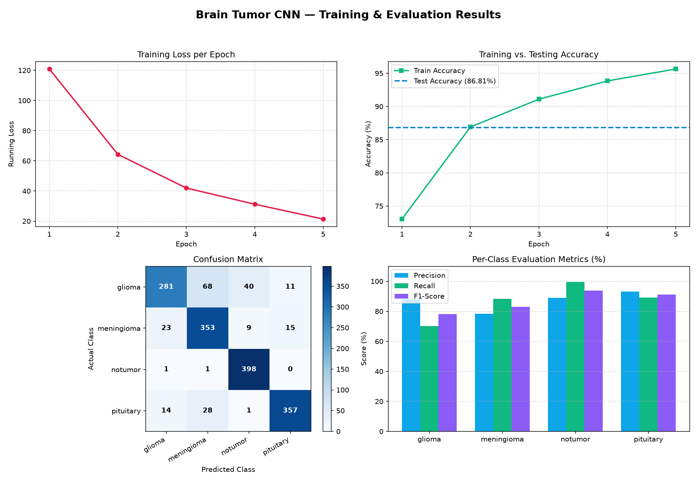

# 🧠 Brain Tumor Classification using CNN

A beginner-friendly **Convolutional Neural Network (CNN)** project for classifying brain MRI images into four categories:

- **Glioma**
- **Meningioma**
- **No Tumor**
- **Pituitary**

This project is designed as a learning/research starting point for understanding how to work with an image dataset, perform preprocessing, build a CNN in PyTorch, train the model, evaluate its performance, and make predictions on individual images.

> ⚠️ **Important:** This is an educational/research project and is **not a medical diagnostic system**. The reported accuracy should not be interpreted as clinical performance.

---

## 📌 Project Overview

The model takes brain MRI images as input and predicts one of four classes.

### Workflow

```text
MRI Dataset
    │
    ▼
Image Preprocessing
(Resize → Tensor)
    │
    ▼
PyTorch ImageFolder
    │
    ▼
DataLoader
    │
    ▼
CNN
    │
    ├── Conv2D (3 → 32)
    ├── ReLU
    ├── MaxPool
    ├── Conv2D (32 → 64)
    ├── ReLU
    ├── MaxPool
    ├── Flatten
    └── Fully Connected (65536 → 4)
    │
    ▼
Class Prediction
    │
    ├── Glioma
    ├── Meningioma
    ├── No Tumor
    └── Pituitary
```

---

## 📂 Project Structure

```text
BrainTumor_CNN/
│
├── dataset/
│   ├── Training/
│   │   ├── glioma/
│   │   ├── meningioma/
│   │   ├── notumor/
│   │   └── pituitary/
│   │
│   └── Testing/
│       ├── glioma/
│       ├── meningioma/
│       ├── notumor/
│       └── pituitary/
│
├── cnn.py
└── README.md
```

The dataset is organized according to the directory structure expected by `torchvision.datasets.ImageFolder`.

The current dataset contains:

- **5,600 training images**
- **1,600 testing images**
- **400 testing images per class**

Class-to-index mapping used by the program:

```text
glioma     → 0
meningioma → 1
notumor    → 2
pituitary  → 3
```

---

## 🛠️ Technologies Used

- **Python**
- **PyTorch**
- **Torchvision**
- **Scikit-learn**
- **NumPy**
- **Matplotlib**
- **CNN / Deep Learning**

---

## 📦 Installation

Make sure Python is installed, then install the required packages:

```bash
pip install torch torchvision scikit-learn matplotlib
```

You can also install them individually:

```bash
pip install torch
pip install torchvision
pip install scikit-learn
pip install matplotlib
```

---

## ▶️ How to Run

Clone the repository:

```bash
git clone <YOUR_GITHUB_REPOSITORY_URL>
```

Move into the project directory:

```bash
cd BrainTumor_CNN
```

Run the CNN:

```bash
python cnn.py
```

The program will:

1. Load the training dataset.
2. Load the testing dataset.
3. Resize images to `128 × 128`.
4. Convert images to PyTorch tensors.
5. Create training and testing DataLoaders.
6. Build the CNN.
7. Train the model for 5 epochs.
8. Calculate training accuracy.
9. Evaluate the model on the testing dataset.
10. Generate a confusion matrix.
11. Generate a classification report.
12. Test the model on one individual test image.

---

# 🔄 Image Preprocessing

The current preprocessing pipeline is:

```python
transform = transforms.Compose([
    transforms.Resize((128, 128)),
    transforms.ToTensor()
])
```

### 1. Resize

Every input image is resized to:

```text
128 × 128 pixels
```

This ensures that all images have the same dimensions before being passed to the CNN.

### 2. ToTensor

`ToTensor()` converts the image into a PyTorch tensor and scales image pixel values to approximately:

```text
[0, 1]
```

Because the input images are RGB, the CNN receives:

```text
[batch_size, 3, 128, 128]
```

For example:

```text
torch.Size([1, 3, 128, 128])
```

---

# 🧠 CNN Architecture

The CNN is intentionally kept simple so that the architecture and training process are easy to understand.

```text
Input
3 × 128 × 128
      │
      ▼
Conv2D
3 → 32 channels
3 × 3 kernel
      │
      ▼
ReLU
      │
      ▼
MaxPool 2 × 2
      │
      ▼
Conv2D
32 → 64 channels
3 × 3 kernel
      │
      ▼
ReLU
      │
      ▼
MaxPool 2 × 2
      │
      ▼
Flatten
      │
      ▼
Fully Connected
65536 → 4
      │
      ▼
4 Class Scores
```

### CNN Code

The first convolution extracts low-level visual features:

```python
self.conv1 = nn.Conv2d(
    in_channels=3,
    out_channels=32,
    kernel_size=3,
    padding=1
)
```

The second convolution extracts more complex features:

```python
self.conv2 = nn.Conv2d(
    in_channels=32,
    out_channels=64,
    kernel_size=3,
    padding=1
)
```

Max pooling reduces the spatial dimensions:

```python
self.pool = nn.MaxPool2d(2, 2)
```

Finally, the extracted features are classified into four classes:

```python
self.fc = nn.Linear(
    64 * 32 * 32,
    4
)
```

---

# ⚙️ Training Configuration

The current experiment uses:

| Parameter | Value |
|---|---:|
| Image size | `128 × 128` |
| Batch size | `32` |
| Optimizer | Adam |
| Learning rate | `0.001` |
| Loss function | Cross Entropy Loss |
| Epochs | `5` |
| Output classes | `4` |

Loss function:

```python
criterion = nn.CrossEntropyLoss()
```

Optimizer:

```python
optimizer = torch.optim.Adam(
    model.parameters(),
    lr=0.001
)
```

---

# 📊 Results



The model was trained multiple times. Since the current script does not set a random seed, results can vary between runs.

One of the recorded runs produced:

```text
Epoch [1/5] Loss: 20.6343 Accuracy: 96.23%
Epoch [2/5] Loss: ...
...
Epoch [5/5] Loss: 20.6343 Accuracy: 96.23%

Test Accuracy: 86.62%
```

The most recent complete run reported:

```text
Test Accuracy: 86.62%
```

### Confusion Matrix

```text
[[272  71  44  13]
 [ 25 335  14  26]
 [  1   0 399   0]
 [ 13   7   0 380]]
```

Rows represent the **actual class**, while columns represent the **predicted class**.

Class order:

```text
0 → glioma
1 → meningioma
2 → notumor
3 → pituitary
```

### Classification Report

| Class | Precision | Recall | F1-score | Support |
|---|---:|---:|---:|---:|
| Glioma | 0.87 | 0.68 | 0.77 | 400 |
| Meningioma | 0.81 | 0.84 | 0.82 | 400 |
| No Tumor | 0.87 | 1.00 | 0.93 | 400 |
| Pituitary | 0.91 | 0.95 | 0.93 | 400 |
| **Overall Accuracy** | | | **0.87** | **1600** |

### What the results suggest

The model performs particularly well on the **No Tumor** and **Pituitary** classes in this experiment.

The **Glioma** class has a lower recall (`0.68`), meaning a noticeable number of actual glioma images were classified as other categories.

This can be seen in the confusion matrix:

```text
Actual Glioma
      ↓
272 correctly classified
71  → Meningioma
44  → No Tumor
13  → Pituitary
```

This is an important limitation to investigate in future experiments.

---

# 🔍 Single Image Prediction

The script also tests one individual image from the testing dataset:

```python
image, label = test_dataset[0]
image = image.unsqueeze(0)

with torch.no_grad():
    output = model(image)

predicted_class = torch.argmax(output, dim=1)
```

Example output:

```text
Single image shape: torch.Size([1, 3, 128, 128])

CNN output:
tensor([[-12.8537, -1.9320, -1.0222, -4.7808]])

Output shape:
torch.Size([1, 4])

Predicted class:
2

Actual class:
0

Predicted class name:
notumor

Actual class name:
glioma
```

In this example, the model incorrectly predicted a glioma image as `notumor`.

This demonstrates why **test accuracy alone is not enough** when evaluating a medical-image classification model. Class-wise precision, recall, F1-score, and the confusion matrix are also important.

---

# 📈 Training vs Testing Performance

An interesting observation from the experiment is:

```text
Training Accuracy ≈ 96%
Testing Accuracy  ≈ 87%
```

The difference suggests that the model performs considerably better on the training data than on unseen testing data.

This may indicate **overfitting**.

Possible improvements include:

- Data augmentation
- Dropout
- Batch normalization
- Weight decay
- Learning-rate scheduling
- More training/validation experiments
- A deeper or better-designed CNN
- Transfer learning using pretrained models
- Hyperparameter tuning

---

# 🚀 Future Improvements

This project is intentionally a simple baseline. Possible next steps include:

### 1. Add Data Augmentation

For example:

```python
transforms.RandomRotation(...)
transforms.RandomHorizontalFlip(...)
transforms.RandomResizedCrop(...)
```

This can help the model generalize better.

### 2. Add Validation Dataset

Currently, the project uses:

```text
Training → model training
Testing  → final evaluation
```

A better experimental setup would be:

```text
Training → model learning
Validation → hyperparameter/model selection
Testing → final evaluation
```

### 3. Add Normalization

For example:

```python
transforms.Normalize(...)
```

This can make CNN training more stable depending on the dataset and training setup.

### 4. Improve the CNN

The current model contains only two convolutional layers. Future versions can explore:

- Batch Normalization
- Dropout
- More convolution blocks
- Adaptive pooling
- Deeper architectures

### 5. Transfer Learning

Pretrained architectures such as ResNet, EfficientNet, or DenseNet could be investigated and compared against this baseline CNN.

### 6. Add Visualization

Future versions can include:

- Training loss curves
- Training/validation accuracy curves
- Confusion matrix visualization
- Sample predictions
- Misclassified image visualization
- Grad-CAM / explainability

### 7. Reproducibility

The current script does not explicitly set random seeds. Adding deterministic/reproducible settings would make experiments easier to compare.

---

# 🎯 Learning Objectives

This project is useful for learning the complete basic workflow of an image-classification problem:

```text
Dataset
   ↓
Directory Organization
   ↓
ImageFolder
   ↓
Preprocessing
   ↓
DataLoader
   ↓
CNN Architecture
   ↓
Forward Pass
   ↓
Loss Calculation
   ↓
Backpropagation
   ↓
Optimizer
   ↓
Training
   ↓
Testing
   ↓
Confusion Matrix
   ↓
Classification Report
   ↓
Prediction
```

It serves as a foundation for more advanced medical-image research, including segmentation projects such as **U-Net-based brain tumor segmentation**.

---

# 📚 Key Concepts Demonstrated

- Image classification
- Convolutional Neural Networks
- Convolution layers
- ReLU activation
- Max pooling
- Feature extraction
- Flattening
- Fully connected layers
- Cross-entropy loss
- Adam optimizer
- Forward propagation
- Backpropagation
- Gradient descent
- PyTorch `Dataset`
- PyTorch `DataLoader`
- Training vs evaluation mode
- Confusion matrix
- Precision
- Recall
- F1-score
- Single-image inference

---

# 👨‍💻 Author

**Showmik**

This repository is part of a learning/research journey into:

```text
Deep Learning
      ↓
Computer Vision
      ↓
Medical Image Analysis
      ↓
Brain Tumor Classification
      ↓
Brain Tumor Segmentation
```

---

## ⭐ Note

This repository focuses on **learning and experimentation** rather than clinical deployment. The model should not be used to make medical decisions.
